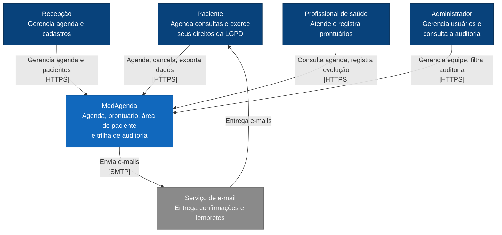
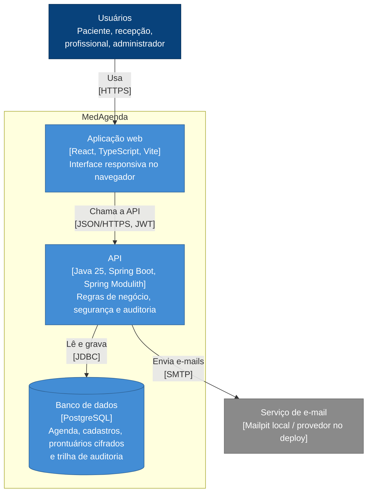
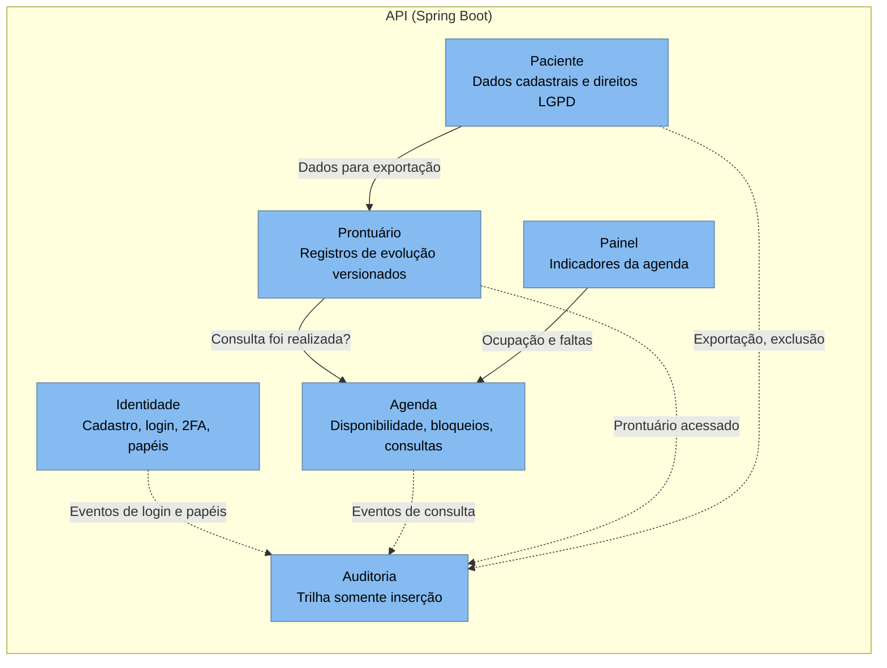

# Arquitetura

Diagramas no modelo C4, do nível mais amplo ao mais detalhado.
As decisões por trás deles estão em [ADRs](../adr/).

## Nível 1: Contexto

Quem usa o MedAgenda e com quais sistemas externos ele se comunica.

## Nível 2: Containers

As partes que rodam separadamente.

## Nível 3: Componentes da API

Os módulos do monolito modular. Linhas contínuas são chamadas à API
pública de outro módulo; linhas tracejadas são eventos de domínio.

O módulo de Identidade é usado por todos os outros por meio do Spring
Security; essas ligações foram omitidas para manter o diagrama legível.